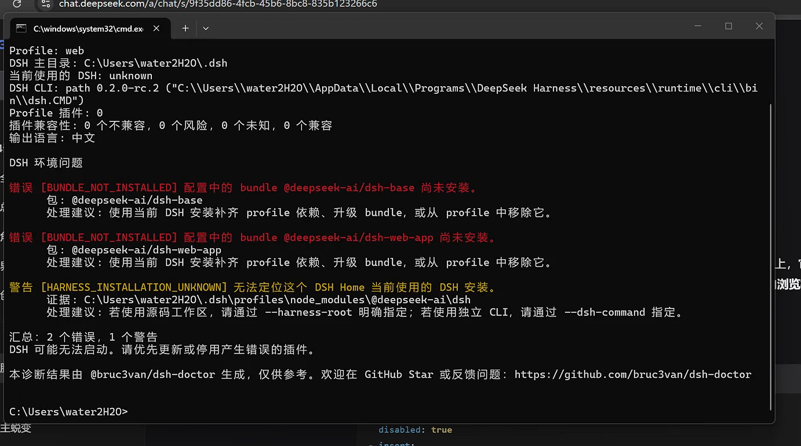
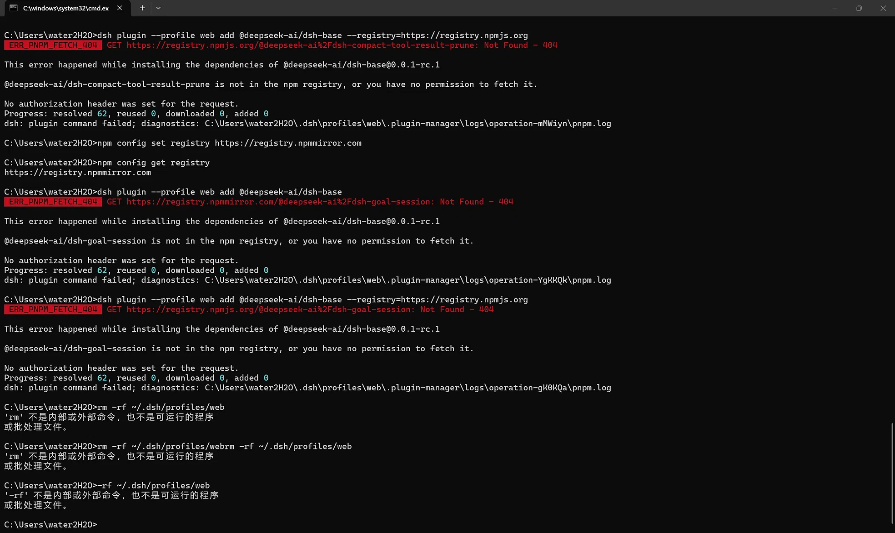
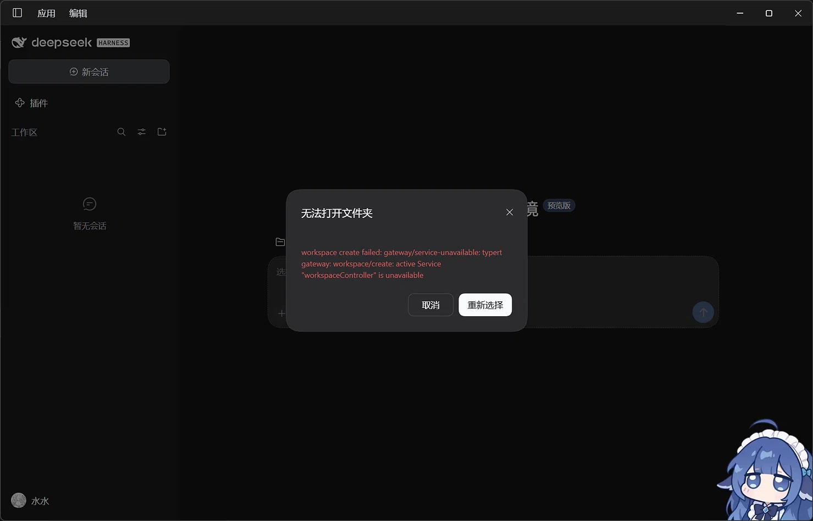

事情很小：工作目录的名字里带了个空格。

小到我一直没管它。直到文件还不算多，想着趁早改成不带空格的，免得以后做工具、写脚本的时候三天两头转义。

然后 DSH 就崩了。

这篇把它写完，因为**结论跟当时以为的完全不一样** —— 中途我一度认定「AI 写的脚本把我的环境搞坏了」，事后查明白：脚本没错，权限错了。

## 一、2:47，改个名字

路径里带空格在 shell 里是要加引号的，很多工具链默认把空格当分隔符。所以我把工作目录改了个不带空格的名字。

这一步本身没错。错的是**这个目录下面挂着一整个运行环境**，而重命名会连带影响它底下的每一条路径引用。

改完之后，DSH 开始反复报错，基本没法用。

## 二、第一次自救：照着诊断结果装包，404

先诊断。诊断工具说有两个 bundle 没装上、还有一个安装位置定位不到：

那就按它说的补装。结果命令走到底：

**404**。也就是说它建议我装的东西，那个地址上根本没有。这条路断了。

## 三、3:40，重装

从 2:47 折腾到 3:40，快一个小时，没找到能修的办法，最后直接删掉重装。

环境回来了，能用了。但**聊天记录虽然本地有备份，仍然恢复不回来** —— 版本对不上，那些对话也就留在旧的那份数据里了。

这一夜最亏的地方不是重装，是这个。

## 四、事后查到的真正原因

第二天冷静下来重新看，问题**不在那个空格本身**，也不在我改名的动作。

是**权限坏了**，而且坏得很隐蔽：

| 层级 | 实际权限 |
|---|---|
| 工作区根目录 | 有一条明确给本人的权限项 ✓ |
| 往下一层 | **断了** —— 没有继承下来 |
| 子目录 | 只剩沙箱自己的授权 + 一条继承来的「删除子目录及文件」**拒绝**项 |

于是整个工作区**除了最外层，一律拒绝写入**。

这意味着什么？意味着我后来跑的每一个修复脚本，都在撞同一堵墙 —— 不是哪个脚本写错了，是那个位置**根本不许写**。写脚本的 AI 换谁来都一样。

而重命名那次操作正好把权限项的继承关系抖掉了一环，之前一直能写是因为还挂在继承链上。

## 五、所以「AI 别写脚本」这个结论对吗

当时的标题就是这句吐槽。后来想想，**一半对一半不对**。

不对的那半：脚本本身没做错什么，它们在没有任何写权限的地方执行，动作都对，结果全错。这个锅不该由脚本背。

对的那半：那晚之后，我确实不再随便运行来路不明的 `.ps1` 文件了。理由不是「它一定会出错」，而是：

- **我不知道它会动哪些目录** —— 一个要重排权限的脚本，和它的名字通常不相称
- **出错之后我看不懂它在干什么** —— 那晚最耗时的部分不是修复，是**判断**，而判断需要读得懂每一步
- **它没有「只读试跑」这一步** —— 真要做破坏性操作，先 dry-run 打印计划，人看一遍再执行

## 六、记三条

1. **看到「拒绝访问」，先查权限，别先查代码。** `icacls <目录>` 一层层看继承，比读脚本快得多。
2. **给 AI 的脚本加一个 dry-run 开关。** 打印「我将要做什么」，而不是直接做。
3. **重命名一个挂着运行环境的目录，等于动它的所有配置文件。** 想改就趁早 —— 环境还没长起来的时候改。

---

现在这个工作区名字里没有空格了。代价是一个通宵、一份回不来的聊天记录，以及一篇写了两遍才写对原因的博客。
