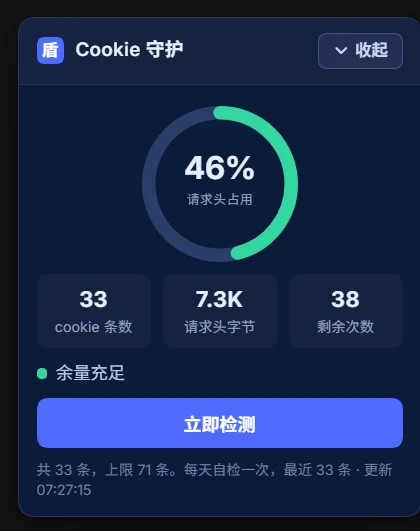

DSH 桌面版打不开的时候，报错很简短：

```text
desktop welcome: Web authentication failed
```

窗口还在，数据也还在，就是进不去。乍看像登录出了问题，可继续查下去，才发现请求根本没走到正常的认证流程。

真正的线索是这个状态码：

```text
431 Request Header Fields Too Large
```

请求头太大了。

## 随机端口，固定留下来的 cookie

这次排查涉及的版本，每次启动会通过 `--port 0` 让系统分配一个端口。访问本地页面时，服务端返回 `303`，同时设置一个认证 cookie；它的名字里包含根据 `127.0.0.1:<端口>` 算出的标识。

单看这两步都不奇怪，放在一起就有点麻烦了。

**cookie 不按端口隔离。** 浏览器主要依据域名、路径等条件决定发送哪些 cookie，而这里又把端口编码进了 cookie 名。端口换了，名字也跟着换，新 cookie 就不会覆盖旧 cookie；旧的还留在同一个本地主机下面。

于是，本来只想给这次启动发一张通行证，最后却留下了一叠过期的门票。名字各不相同，后续请求还可能把它们一起带上。

按这次记录，每条约占 228 字节。33 条就是：

```text
33 × 228 = 7524 字节
7524 ÷ 16384 ≈ 45.9%
```

拿 16 KiB 的请求头上限粗算，`16384 ÷ 228 ≈ 71.86`，看上去像是攒到第 72 条就会出问题。不过这不是精确的“启动倒计时”：请求头里还有其他字段，cookie 是否过期、服务端的上限配置，也都会影响结果。

所以原先那个“第 72 次启动”的标题，更适合当一个提醒，不能真拿来当保证。

## 还没坏，也能先看看

为免下次又是窗口先报错，我给它加了个 `cookie-guard` 浮窗，放在右下角看占用。



截图里是 33 条、7.3K、46%。对应记录里的精确值是 7524 字节和 45.9%；一个用了 KiB 和整数百分比，一个保留了原始数字，看的其实是同一份数据。

浮窗还给了“剩余 38 次”的估算。它能提醒我该清理了，但不代表前 38 次一定安全。比起等认证失败以后再找原因，我更愿意提前看到这个数字往上走。

当时的读取记录标着 `borrowed-handle`。这和 Chromium 运行时数据库文件可能被占用有关，属于这个诊断工具的实现细节；普通使用者没必要照着折腾，更不应该把原始 cookie 值贴到公开日志里。

## 清理之前，先退出和备份

这次的临时处理办法是：先从托盘完整退出 DSH，再备份对应浏览器配置目录中的 `Cookies` 数据库及相关日志文件，清理后重新打开、重新登录。

这里得分清两件事：

- 关掉窗口，不一定等于退出进程；
- 清整个 cookie 库，可能会影响这个配置里其他站点的登录状态。

因此，能只清理旧的本地认证 cookie，就不要扩大到整个库；需要动数据库文件时，也先确认是哪个浏览器配置、备份是否留好。别为了修一个登录问题，顺手把别处的登录也清了。

清理能缓解这一次，但如果生成和保留 cookie 的方式不变，之后还是可能继续积累。

## 报错说的是认证，问题却在更前面

这次最绕的地方，是最先看到的那句“认证失败”。它把注意力引向了登录，可真正出问题的是请求头大小：请求在进入应用认证逻辑之前，就已经被拒绝了。

随机端口本身不是问题，持久化 cookie 也不是问题。问题是每次都生成一个新名字，又没有相应的过期、覆盖或清理策略。

本来是一次启动用完就该收走的东西，最后却一张张留下来了。

现在右下角多了个仪表。我当然希望它一直绿着——但更希望以后根本不需要靠这个仪表，来判断应用还能不能打开。
