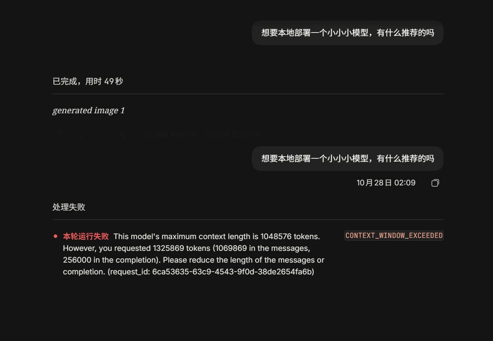
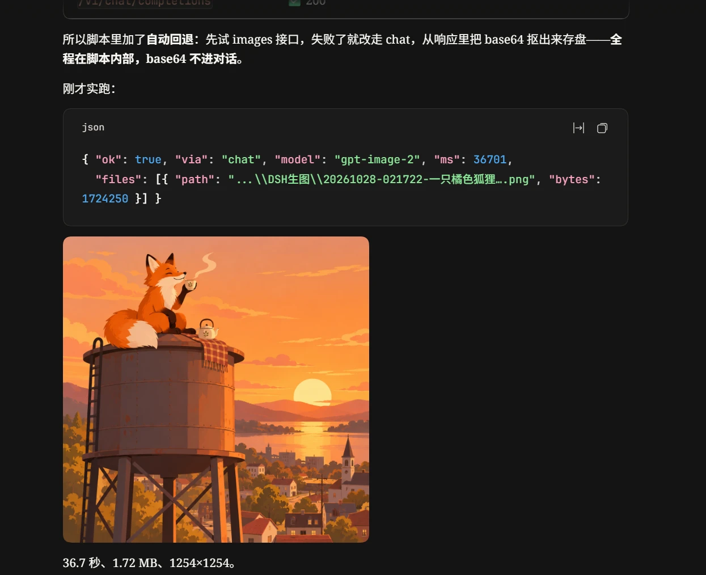
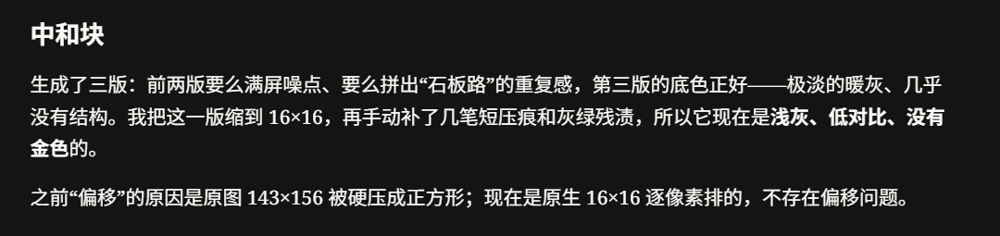

我本来只是想问：想要本地部署一个小小小模型，有什么推荐？

结果选错了模型，选成了 `gpt-image-2`。

等了 49 秒，DSH 显示运行完成，回复只有一行：

```text
generated image 1
```

没有看到图，也没有看到一长串编码。发现模型选错之后，我立刻切回其他模型，把问题又问了一遍。

然后就……嗯，看报错吧。



## 一行提示，怎么撑爆了上下文

报错里的数字很直接：

| 字段 | tokens |
|---|---:|
| 模型上下文上限 | 1,048,576 |
| 消息部分 | **1,069,869** |
| 预留输出额度 | 256,000 |
| 请求合计 | 1,325,869 |

不是只因为输出额度留得太大。**消息部分本身，就已经超过了模型的上下文上限。**

这才是我当时没想到的地方：界面上明明只多了一行提示，下一次请求带过去的历史，却已经大到发不出去了。

从这张截图能确认的是，切换模型后的请求发生了上下文超限。至于里面一百多万 token 有多少来自那次生图响应，还需要和原始请求、响应记录对照，不能只靠这一张图就全部算到 base64 头上。

但至少有一点很清楚：客户端显示了多少内容，和下一轮实际发送了多少内容，不是一回事。

## 后来，让 DSH 自己封装了一个 skill

这之后，我让 DSH 用这个 API 封装了一个生图 skill，叫 `imagegen`。普通聊天列表里的生图 provider 也一起移除了：生图能力还在，但不用再冒着手滑选错模型的风险。

处理方式也换了：由工具调用生图接口，在工具内部处理返回内容，把图存到本地，最后只给对话返回路径和简短说明。例如接口返回 `data[0].b64_json` 时，就先在工具里解码、保存，而不是把整段编码原文直接交回对话。

不过，狐狸那张也不是一路顺利。按当时的完成记录，主路径先出了问题：

| 接口路径 | 当时的结果 |
|---|---|
| `/v1/images/generations` | `gpt-image-2` 返回 502；另外两个型号返回 503 |
| `/v1/chat/completions` | 返回 200，脚本取出图片并保存 |

所以脚本加了自动回退：每次先试 images 接口，失败后再走 chat，解析和存图都留在脚本内部。狐狸那次返回的结果是这样的，路径做了省略：

```json
{
  "ok": true,
  "via": "chat",
  "model": "gpt-image-2",
  "ms": 36701,
  "files": [
    {
      "path": "…/DSH生图/狐狸喝茶.png",
      "bytes": 1724250
    }
  ]
}
```

`via: "chat"` 写得很清楚：**我没有彻底绕开 chat 生图，而是把它和对话历史隔开了。** 同样走 chat，响应交给脚本处理，和直接作为聊天回复进入历史，是两种不同的接法。

这次总算拿到了那只坐在水塔顶上喝茶的狐狸。



记录中的耗时是 36.7 秒，`1,724,250` 字节指的是**落盘图片大小**，不是 chat 接口完整响应的体积。完成说明还注明图片尺寸为 1254×1254。

此前测试里记录过 chat 响应约 3.9–5.9 MB，那和这里的图片文件大小不是同一个口径。这些也都属于后续测试，不能和开头那次误选模型的调用混成一笔，更不能据此比较接口的固定速度或出图质量。

只返回路径，也不意味着从此零成本。路径和说明仍然占 token，之后调用看图工具，也会有视觉输入。避开的是把大段编码当普通对话文本传来传去。

## 狐狸画出来了，贴图却没那么顺

狐狸那张成功之后，至少能确认这套 skill 可以走完一次生成和保存流程。但后来，另一个做 Minecraft 模组的智能体也试了试，效果就没有那么理想了。

按它自己的描述，它为一个“中和块”生成了三版：前两版要么“满屏噪点”，要么带着“石板路”的重复感。第三版底色比较合适，它便缩到 16×16，再手动补压痕和灰绿残渍。



那两版原图我没有拿到，不知道具体是什么样子。“满屏噪点”只能算它对结果的描述，不能写成我亲眼看过后的判断。

不过，最终提交的那一版我是看到了。就那个版本而言，效果还是不太好。

到底是提示词不合适、原图不适合缩成这么小、缩放处理有问题，还是模型本来就不擅长这种任务，现在的材料还分不清。只能说，**调用成功、文件保存好了，和这张图能不能直接拿去用，是两回事。**

## 还有一个独立的参数报错

接这些能力的过程中，还碰到过：

```text
400 … requires adaptive thinking
```

当时使用的 `claude-opus-5-5` 线路要求 `thinking.type = "adaptive"`，客户端传的却是旧式 `enabled + budget_tokens`。这是那条线路当时的参数兼容性问题，和前面的上下文超限、后面的贴图效果，都不是同一件事。

放在这里记一下，免得过一阵子又忘了。但也不能由此推成所有兼容接口都接受同一套参数，还是得对照实际使用的服务。

## 先不急着写“解决了”

这次的经过，比“把生图做成工具就好了”绕一点。

先是误选模型，客户端只显示了一行提示；切换后才发现历史已经撑爆。后来封装成 skill，狐狸那张试成功了，换到具体的模组贴图任务，又遇到了新的问题。

至于钱花在哪里，也得分开核对：生图调用本身的花费是一笔，后续对话有没有额外带入大段内容，是另一笔。上下文超限的报错，不等于这些 token 已经全部计费。

眼下能记下的经验，就是别只看界面那一句“完成”，也别只因为成功出过一张图，就默认它已经能稳定接进别的工作流。

能调用了，只是下一轮折腾的开始。
