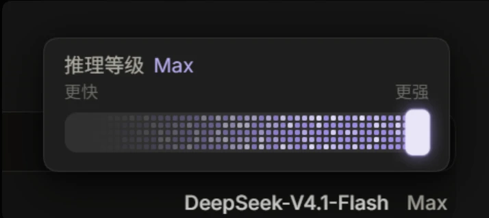
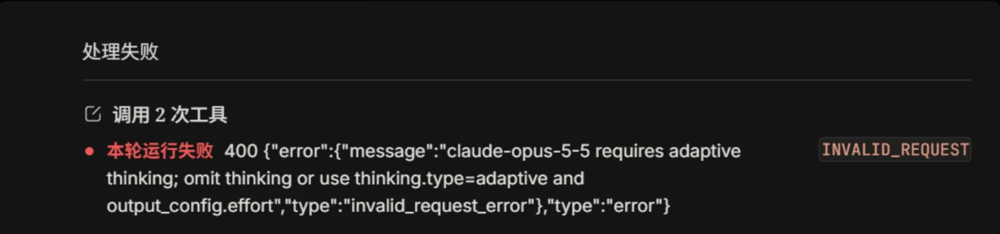

DSH 里有个思考强度滑块。从“更快”拉到“更强”，看着很直观：日常问题少想一点，难题就往右拉。

我给 Claude 也加上了这个控制。结果再次调用时，它没开始多想，先给我回了一条 400。



先说明一下，上面是当时滑块的界面截图，显示的是 DeepSeek 官方通道。它用来说明这个控件长什么样，不是 Claude 报错时的模型选择截图。

## 这次不是上下文塞满了

前面刚碰到过一次上下文超限，看到红色报错，很容易往长度上想。但这次写得很明确：

```text
400 invalid_request_error
claude-opus-5-5 requires adaptive thinking;
omit thinking or use thinking.type=adaptive and output_config.effort
```



它嫌的不是消息太长，而是我带过去的参数格式不合要求。

滑块在界面上只有一个位置，落到请求里却不是一个通用开关。客户端得把档位翻译成接口认识的字段；同样叫“推理强度”，换一条协议或线路，传法可能就不一样了。

按当时保存的排查记录，同一条 Claude 线路试了三种方式：

| 发法 | 返回结果 |
|---|---|
| 不发 `thinking` | 200 |
| `thinking: {type: "enabled", budget_tokens: 1024}` | 400 |
| `thinking: {type: "adaptive"}`，配合 `output_config.effort` | 200 |

也就是说，旧式 `enabled + budget_tokens` 正好撞上了这条线路的参数校验。这是当时该接口的结果，不是说所有 Claude 接口、所有版本都只能这样发。

## 先让它能用，再看代价

当时先试过在模型配置里加 `forceAdaptiveThinking: true`，希望适配器改用 adaptive 那套格式。但配置写进去了，不等于当前版本的适配器一定认这个开关；那一步还需要重启和验证。

后来我直接选了另一条路：把这条 provider 从 `anthropic-messages` 切到 `openai-completions`，走中转提供的 OpenAI 兼容端点。

这不是给官方 API 换个名字就能通用，而是那家中转恰好提供了这个入口。当时记录里的验证调用带了 `reasoning_effort: "max"`，返回 HTTP 200，正常拿到了正文。

至少，400 不再挡着用了。

不过，换协议也有代价。原生的 thinking 块、显式 prompt caching 标记等能力，不一定能通过兼容层原样保留。没看到 thinking 明细，不等于服务端一定没推理；同样，也不能凭一个 200，就认定所有参数都按预期执行了。

## 那 GPT 的滑块，会不会也只是装饰？

修完 Claude，我反而开始怀疑另一个问题：既然不同线路处理参数的方式不一样，那我平时给 GPT 拉的这个滑块，到底有没有效果？

于是又做了一轮小测试。同一道题，每档各跑一次。下面是当时对话里保存的整理结果，不是这次写文章时重新跑的基准测试。

| 模型 | 档位 | 输出 token | 其中上报的推理 token | 答案 |
|---|---|---:|---:|---|
| gpt-6.1-sol | off（不发字段） | 45 | 38 | 654 |
| gpt-6.1-sol | high | 51 | 44 | 654 |
| gpt-6.1-sol | max | 76 | 69 | 654 |
| gpt-6-astra | off | 37 | 30 | 654 |
| gpt-6-astra | high | 43 | 36 | 654 |
| gpt-6-astra | max | 79 | 72 | 654 |
| claude-opus-5-5（兼容端点） | off | 48 | 未上报 | 654 |
| claude-opus-5-5（兼容端点） | high | 51 | 未上报 | 654 |
| claude-opus-5-5（兼容端点） | max | 34 | 未上报 | 654 |

“输出”和“推理”是记录里的两个字段，不应直接相加；具体包含关系仍要看接口的 usage 定义。

GPT 两组数据里，推理 token 都随档位增加了，至少和滑块想表达的方向一致。Claude 那组却没有明显规律，也没有上报推理 token，单靠这三次结果，判断不了它究竟怎样处理了档位。

我另外还记得，Astra 拉到 max 后，token 消耗比 high 多了 20% 多。不过，那次的完整对照记录目前还没补进来，不能把它当成上表的计算结果：上表中推理 token 是 36→72，输出 token 是 43→79，显然不是“多 20%”这一组。

这两份记录先分开放着，免得写着写着，把不同测试揉成了一个漂亮但对不上的数字。

## 不报错、生效、答得更好，是三件事

回头看，这一轮其实绕着三个问题打转：

- 接口接不接受这个参数？
- 接受以后，它有没有按档位改变行为？
- 改变行为以后，答案有没有变好？

HTTP 200 只回答了第一问。它可能执行了参数，也可能做了转换，甚至可能忽略了字段，不能光看状态码判断。

token 变化能提供一些线索，但这次每档只跑了一次，天然就有波动。更何况表里的答案全是 654，题目没有把质量差异拉开，也就谈不上“max 比 high 聪明多少”。

因此，现在还不能说 Claude 的滑块一定没用，也不能把 GPT 这次的消耗变化推广成固定倍率。想看清楚，还得用相同条件、多道题、重复几轮，再结合原始请求和 usage 一起核对。

本来只是给界面加一个滑块，最后发现它后面还隔着客户端、适配器、中转和模型，各自都可能有自己的理解。

所以现在我看到那个 Max，会稍微冷静一点。拉到最右边很容易，确认它到底拉动了什么，就没那么省事了。
