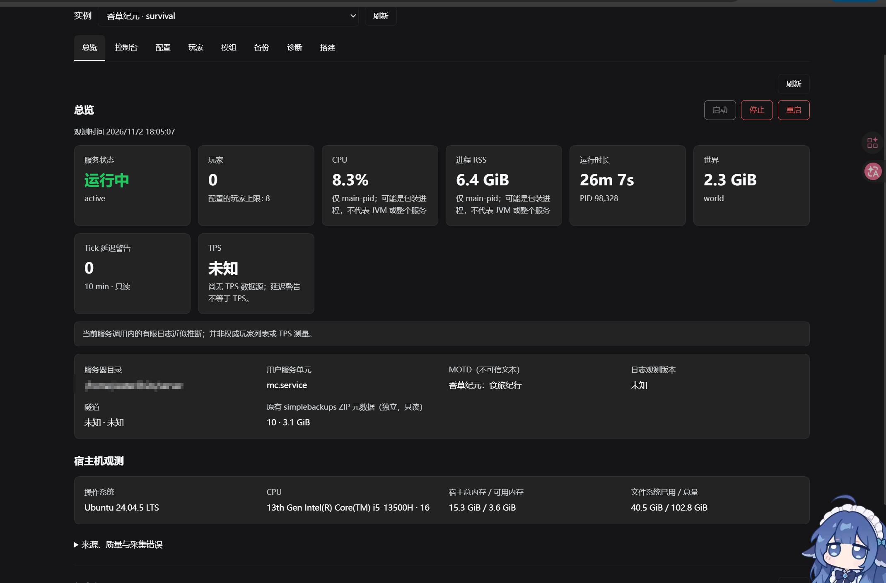

## 开端

上上周周末（10月25号）的时候，我开了一个《香草纪元：食旅纪行》的服务器，这是一个休闲冒险向的整合包，总体玩法比较轻松，怪物难度也不高，就是……模组有一点点多，可能对渣机不太友好……

周一（26号）我从大陆返回香港，内网穿透也换了海外节点。结果或许是因为带宽不够的原因，许多朋友都是刚进来就立马被踢出去。

然后因为本地不是专门的服务端拿不到完整的错误报告，再加上用户端开服确实会造成这种问题，所以暂时联机计划不得不被搁浅下来。

结果好巧不巧，上周（10月31号）又因为学校活动无法返回大陆。

联机不想就这么算了，望着自己旁边那台闲置的轻薄本我忽然有个想法……

“我是不是，开学的时候就说要在这个上面装个Linux系统来着的……！”

## 一番捣鼓之后，也是有惊无险的完成了Linux系统的安装

于是很自然的想到了Linux一个广为人知的常见应用：服务器

准确来说是：把《香草纪元：食旅纪行》的服务端和原来的世界搬到 Linux 笔记本上，Windows 负责玩，笔记本负责开服，再让朋友也能连进来。手头有机器、有整合包、有存档，听起来像是把文件搬过去、配好 Java 就行。

后来发现，Java 能启动只是第一关。

从 10 月 31 日折腾到 11 月 1 日，补记到 11 月 2 日凌晨，事情慢慢变成了：这边查端口，那边换联机路径，再给 DSH 写管理插件，最后还拿着真实世界文件修了一轮解析器。

这篇把经过记下来。时间统一按 UTC+8；截图和数值都是当时留下的记录，不是现在重新测出来的在线状态，也不是一份照着执行就能复刻的安装教程。

> 11 月 6 日补记：服务器已于当天凌晨结档。前半篇保留 11 月 2 日写下的两天经历，后续统计、网络故障和插件进展放在文末的“结档以后，再算算这几天”。不同阶段的测试数和运行状态，按各自记录时间理解。

## 先把旧世界搬过去，别开成了一个新世界

这次没买云服务器，用的是手头的笔记本：

| 项目       | 当时的环境                                 |
| -------- | ------------------------------------- |
| 系统       | Ubuntu 24.04，x86_64                   |
| CPU / 内存 | i5-13500H，系统识别总内存约 15 GiB             |
| 游戏 / 加载器 | Minecraft Java 1.20.1 / Forge 47.3.33 |
| Java     | 独立安装的 JDK 17                          |
| 客户端      | Windows，使用对应整合包                       |
| 模组文件数    | 后续统计为 398 个                           |

Forge 服务端不是拿一个原版 JAR 随便跑起来就完事。这里用到的是它自己的启动参数文件：

```text
libraries/net/minecraftforge/forge/1.20.1-47.3.33/unix_args.txt
```

当时 JVM 堆给了 `-Xms4G -Xmx8G`，调整过 G1 参数，也移除了 `AlwaysPreTouch`。这只是这台机器当时的配置，不是什么通用最优解。整机也就十五六 GiB 内存，系统、DSH 和其他进程还得有地方待。

相比参数，更需要确认的是：**它加载的是不是原来的世界。**

启动一个全新的世界也能成功，控制台照样会有就绪日志，但那不叫迁移成功。这次对上传的世界归档和实际加载内容做过核对，元数据对应 1.20.1，`DataVersion=3465`。后来继续游玩，世界和备份体积都在增长，所以不同时间的容量数字也不能直接拿来判断“是不是搬错了”。

运行方式则改成了 systemd 用户服务 `mc.service`，不用再靠某个 SSH 窗口一直开着。检查入口也固定了下来：

```bash
# 服务管理器：这个用户服务现在是什么状态？
systemctl --user status mc.service

# 应用日志：Java 和 Minecraft 实际输出了什么？
journalctl --user -u mc.service -n 100 --no-pager

# 监听端口：服务实际开在哪个 TCP 端口？
ss -tln
```

这三样后来反复用到，因为它们回答的不是同一个问题。

## 服务开着，朋友还是进不来

最先查清楚的一次，是隧道转发错了端口。

SakuraFrp 的目标曾经指向 **9411**，而 Minecraft 实际监听的是 **47060**。目标修正、frpc 重启之后，这条联机路径才恢复。

隧道进程显示 active，看着确实很让人放心——但它只说明进程在运行，并不保证流量最后到了游戏服务。更别说 DSH 面板也有自己的端口：浏览器能打开面板，与 Minecraft 客户端能不能加入，完全是两件事。

另一次更朴素。


看到“未知的主机”，很容易开始查 DNS、看地址格式、怀疑网络。后来核对，**那次输入的地址末尾多了空格**。

截图只能证明客户端报了“未知的主机”，空格这个原因来自后续确认，不能从截图里直接读出来。不过下次复制地址时，我大概会先看看首尾，再去折腾 DNS。

还有这种：


`Connection timed out: getsockopt` 和前面的名字解析失败，又不是同一种故障。期间还遇到过连接重置、不同隧道节点表现不一致。校园网络下，直接访问笔记本的公网游戏端口没有成功；当时也确认 UFW 未启用，不能看到“连不上”就说是 Linux 本机防火墙挡了。

后来把验证拆成了三层：

| 路径 | 要确认的事情 |
| --- | --- |
| 本机回环 | Minecraft 自身是否启动，并能响应游戏协议查询 |
| Tailscale | 专网这一条路径是否可用 |
| SakuraFrp | 隧道是否真正转发到游戏服务，而不只是 frpc 活着 |

再往下，还要分清名字解析、TCP 连接、Minecraft 状态查询和真正进服。TCP 能握手，是一个证据；游戏协议能返回版本和人数，是另一个证据；玩家完整加入并实际游玩，还得继续验证。

这次做过 TCP 和 Minecraft 状态握手测量，但我不把它们写成“游戏里就有这么低的延迟”。同样，Linux 主机一次 DNS 查询慢，也不能直接套到 Windows 客户端身上。

## 掉线了，先别急着叫“崩服”

一边调配置、一边看服务，有时候特别容易把时间上靠近的两件事连在一起。

有一次以为服务器崩了，回头看日志，实际是收到了 `SIGTERM`，随后保存并退出，也没有对应的崩溃报告。至少从这段记录看，更像是一次正常停止或重启。它刚好发生在配置变更附近，也不足以证明就是面板把服弄坏了。

备份与超时也曾挨得很近。可当时没有足够的记录说明备份到底卡了主线程多久，就不能把它写成已经找到的根因。

后来调整了 SimpleBackups：

- 备份策略使用 `MODIFIED_SINCE_LAST`；
- 定时周期 60 分钟，完整备份周期 1440 分钟；
- 保留数量为 10。

这些调整是为了控制备份成本和磁盘增长，不是已经证明能修好卡顿的配方。备份要有，但不能只看着文件不断增加，就当恢复这件事已经稳了——完整恢复演练还没做。

`Can't keep up!` 也一样。启动时加载模组和世界出现一次，与运行中持续刷屏，不应该用同一个结论解释。

## 查得多了，干脆做个工作台

状态、日志、配置、玩家、模组、备份、诊断，还有两条联机路径，都要反复检查。于是 `mcstat-panel` 从简单的状态工具，慢慢扩成了 DSH 里的多实例工作台。

做它不只是为了把命令变成按钮，还得把操作边界先定好：

> 查询可以先做；写入先看预览、再确认。返回“已排队”，不等于操作已经成功。

Agent 也走独立工具和任务记录，而不是临时写一段 shell，就直接去改服务器。

不过，面板自己也先坏了一次。


页面出来了，两块红色报错也出来了：`HTTP 404: invalid JSON response`。

看见“JSON”就查前端 JSON，其实很容易走偏。那时怀疑过旧进程、重载和重复注册，最终还是启动日志给出了明确线索：

```text
StorageError: invalid unit name 'mcstat-panel'
```

宿主对存储单元名的要求是：

```text
^[a-z][a-z0-9_]*$
```

不能有连字符。

结果插件在打开存储时就失败了，后面的 HTTP 路由和 Agent 工具根本没注册上。前端能加载，不代表后端插件已经激活；请求自然也就只拿到了 404。

改的是**存储单元名**，从 `mcstat-panel` 换成 `mcstat_panel`。包名、插件 ID、skill provider 名没有跟着全局替换，因为它们各自有各自的命名规则。不能看起来像同一个名字，就拿一次替换把所有位置一起改了。

另一个前期怀疑也收了回来：profile 里同一个 ID 出现覆盖配置，不等于启动了两个插件实例。

修好以后，工作台总算正常显示了：


这张截图里还写着“尚无注册实例”。它不是下一条故障，而是当时注册表确实为空。这张图证明的是页面恢复了，不能拿来当“服务器已经运行”的截图。

接下来通过 `attach_preview` 生成接管计划，核对现有目录和 `mc.service`，审批后登记为 `survival`。这一步只登记，不改服务端文件，也没有顺便停服、启动或重新安装。

世界和服务器明明已经在那里，没必要为了让面板认识它，再把文件“导入”一遍。

## 到了验收，不能只看 active

11 月 1 日中午，明确请求开服之后，启动任务完成，记录里也有了新的 systemd invocation 和新的 Minecraft 就绪日志。

当次验收留下的结果是：

| 检查项 | 当时的结果 |
| --- | --- |
| 启动任务 | `completed` |
| Minecraft readiness | `ready` |
| 本机游戏协议查询 | 1.20.1，0/8 在线 |
| Tailscale 游戏协议查询 | 成功响应 |
| SakuraFrp 游戏协议查询 | 成功响应 |
| 进程内存 | 约 6.7 GB，十进制口径 |
| 模组文件数 | 398 |
| 配置 | hard，最多 8 人，视距和模拟距离均为 6 |

这不是实时监控数据，也不是完整的进服测试。资料里没有选用能明确证明成功进服的游戏内截图，所以这里能确认的是：**服务启动就绪，三条路径都完成了游戏协议查询**。

难度和人数也与早先接管预览时不同，记录到哪个阶段，就按哪个阶段写，不能没证据就算到某个操作者头上。

期间还有个容易误会的显示：面板曾把隧道标成 disabled，可外部的 `natfrp.service` 实际在运行，协议查询也成功。那是插件里没配置 tunnel provider，不是现实中的隧道停了。

面板知道的状态，和机器上实际存在的服务，还得对得上。

## 930 项测试全过，真实世界还是读不出来

开服以外，这两天还有一段很值得记的插曲。

检查 `refactor/v2` 的 `6cd28c5` 时，自动测试 **930 项全过**。拿真实模组世界的元数据一跑，却得到 `WORLD_UNREADABLE`。

先碰到的是安全预算。

真实元数据解压后约 **4.25 MiB**，约 **34.2 万个节点**，深度没有超过限制；解析器的节点预算却只有 10 万。文件不是坏的，而是合法数据比测试样本大，先被安全上限拦住了。

于是把节点数与累计列表元素的预算提高到 100 万，同时保留字节、深度、解压校验和取消保护，再增加接近真实规模的测试。不是为了让一个世界通过，就把所有限制都拆了。

预算过了，还没完。解析器又把大小写相似的字段当成了冲突。

实际文件里，这三项可以同时存在：

```text
Data.version = 19133     # 旧的存储格式字段
Data.Version = {...}    # 游戏版本元数据
Data.DataVersion = 3465
```

Java NBT 的键是精确、区分大小写的。先统一大小写，或者先做 Unicode 归一化，再判断是不是同名字段，看似在防歧义，实际却把合法文件合并成了“冲突”。

修复后，只精确匹配版本字段；相似名字不再被当成版本证据。关键字段精确重复、类型错误和版本冲突，仍然拒绝。

同一个世界重新验证，结果才对上了：

| 目标版本 | 探测结果 |
| --- | --- |
| 1.20.1 | `same`，DataVersion 3465 |
| 1.19.4 | `downgrade`，返回 `WORLD_TOO_NEW` 阻断 |

到 11 月 2 日凌晨，回归达到 **934/934 通过**，语法检查、前端产物一致性与打包检查也通过了；解包后的 CLI 还重新验了同版本与降级场景。

这次倒是很直观地体会到：测试全过，说明的是测试覆盖到的那些情况全过。真实世界一放进去，才知道小样本没碰到的地方在哪里。

## 最后，留下来的不只是一个能启动的服

插件现在可以协助 Agent 检查本地目录或 ZIP、生成导入计划、安装用户服务并验证启动。但“把整合包交给 Agent”，不应该等于“允许它执行包里所有东西”。

搭建流程被拆成了几步：

```text
只读检查
  → 导入预览与审批，或接管已有目录
  → 可信 Java 的独立版本探测
  → 用户本人明确接受 EULA
  → 服务安装预览与审批
  → 可选自启
  → 单独批准启动
  → 核验就绪日志、游戏协议和目标联机路径
```

没有哪一步会替后面所有步骤一起盖章。

包内 `run.sh`、Forge installer、未知 Java，不自动执行；manifest 里的依赖不自动下载，客户端包也不能当成完整服务端包。EULA 不替人接受，正版验证不自动关闭，RCON、防火墙和公网暴露也不顺手开启。

导入只到新目录；纯世界或单个元数据文件只检查，不提供覆盖恢复。离线世界备份不包含模组、配置和启动参数，hash 对上了，也不等于已经做完游戏级恢复演练。

这些边界当然让“一键开服”没那么一键。不过我宁愿多确认几步，也不想服务器明明已经在那里，Agent 为了帮我省事，先把世界重新收拾了一遍。

截至 11 月 2 日这次补记的时间，插件准备为 2.0.0，用户文档也重写了，但本次发布改动**还没有提交、打 tag、推送或公开发布**。干净 DSH profile 安装、完整浏览器回归、真实导入到首次启动的全链路，以及备份恢复演练，都还需要继续补。

所以这篇先记到这里，就不把它写成一份已经发布的插件广告了2333

本来只是想让朋友进来玩。两天之后，我倒是学会了：配置环境，Linux系统实操，报错处理，内网穿透（甚至还开了个会员）……

最后还多写了一个dsh的服务器面板管理插件：



但硬件都齐了，还是出现了意外——~~就是有朋友因为感冒又来不来了23333~~

欸，朋友，才是游戏的最高配置啊~


---

## 11 月 6 日补记：结档以后，再算算这几天

前面写的是开服最初两天，后来这个世界又继续跑了几天。到 **11 月 6 日 00:46**，这期服务器停服结档，世界目录约 3.0 GB。398 个模组、一个旧世界，加上几位朋友，就这么在轻薄本上续了一小段。

关服以后，我把服务日志和插件的本地改动一起整理了一遍。原本想看看“这几天到底玩了多久”，结果发现，连这个问题也得先定口径。下面按 11 月 6 日的归档记录补写，不是现在重新开服、重新跑插件测试得出的结果。

### 137 小时的跨度，37 小时有人连接

这次统计用的是 `mc.service` 的用户服务日志，共 132,604 行，覆盖了 10 月 31 日迁入部署到 11 月 6 日关服的这一段。它不是游戏内操作记录，所以只能回答“谁在什么时间连接着”，不能回答那个人是不是正在认真种地。

做法是按 `joined the game` 和 `left the game` 配对，把会话裁剪在服务运行窗口内，跨午夜的部分再按天拆开。多人同时在线的区间取并集，只算一次：

- **有人在线时长**：至少一名玩家连接着的墙钟时间。三个人一起待一小时，这里仍是一小时。
- **玩家时长合计**：每个人的在线会话相加。同样那一小时，这里就是三个人时。
- **开服到关服跨度**：从这期开始到结束的日历跨度，包含空服和中途停机，不能当成连续运行时间。

按这个口径，结档记录是：

| 指标 | 结果 |
| --- | --- |
| 开始到结束的跨度 | 137.1 小时，约 5 天 17 小时 |
| 至少一人在线 | 37.21 小时，占整个跨度的 27.1% |
| 玩家在线时长合计 | 95.93 小时 |
| 有人在线时的平均同时在线人数 | 2.58 人 |
| 累计玩家 / 会话 | 5 人 / 60 次，平均每次约 96 分钟 |
| 峰值同时在线 | 4 人，首次出现在 10 月 31 日 20:46 |
| 服务启动 / 停止记录 | 12 / 12 次 |

2.58 的分母是那 37.21 小时，不是整个 137.1 小时。也就是说，服里只要有人，通常就不止一个人；但更多时候，根本没有人连接着。

原来“服务器一直在那里”和“大家一直在玩”，真的差了挺多。

每日拆开更直观：

| 日期 | 有人在线 | 玩家时长合计 | 当日玩家数 | 峰值同时在线 |
| --- | ---: | ---: | ---: | ---: |
| 10 月 31 日 | 6.55 小时 | 21.23 小时 | 4 | 4 |
| 11 月 1 日 | 6.92 小时 | 17.95 小时 | 4 | 3 |
| 11 月 2 日 | 6.78 小时 | 9.98 小时 | 3 | 3 |
| 11 月 3 日 | 0.43 小时 | 0.85 小时 | 2 | 2 |
| 11 月 4 日 | 3.34 小时 | 11.42 小时 | 4 | 4 |
| 11 月 5 日 | 12.42 小时 | 32.19 小时 | 3 | 3 |
| 11 月 6 日，至关服 | 0.77 小时 | 2.30 小时 | 3 | 3 |

各项按两位小数展示，逐日数相加与总数可能差 0.01 小时；同一位玩家也会跨天出现，人数不能逐日相加。

11 月 3 日全天只有大约 26 分钟有人连接，11 月 5 日却累积到了 12.42 小时，是这期最高的一天。按一天里的时段叠起来看，21 点到午夜最热闹，约占全部有人在线时间的三分之一。

我自己的会话合计是 36.20 小时，最长一段 8.24 小时。这个数字看着很肝，但得先把话说在前面：**日志不能识别挂机。** 凌晨连接着，也不代表人就坐在电脑前。因此这里始终叫“在线时长”，不把它包装成有效游玩时长。

朋友的完整游戏名就不在这里做公开排行榜了。另一个局限是，改名可能被当成两个玩家；如果异常退出缺了离开或停止日志，会话边界也只能按运行窗口截断。表格是按现有日志重建的结档记录，不是一个没有误差的全知计时器。

### 隧道后来还换了几次，但掉线仍不等于崩服

最初的端口错配和地址尾随空格，在前面已经写过。后续还有几次不同层的问题：

| 时间 | 当时发生了什么 | 处理与能确认的边界 |
| --- | --- | --- |
| 11 月 2 日 20:45 | 三人同时掉线，校园网这条路径访问樱花 API 不通 | 改走 Tailscale；次日原路径恢复。不能仅凭同时掉线就说 Minecraft 崩了 |
| 11 月 3 日 00:29 | 服务收到手动停止，正常保存后退出 | 记录的退出码为 143，后续重新启动，未见世界数据丢失；退出码本身不等于崩溃证据 |
| 11 月 3 日 | 新分配的隧道节点提示只允许中国内地客户端 | 更换节点，不靠修改游戏配置解决 |
| 11 月 4 日 | 隧道节点再次迁移 | frpc 重连，但朋友需要使用新的入口 |

“校园网这条路径当时不可用”是现象，不在这里把具体拦截策略写成已经证实的结论。

倒是有一条经验越来越明确：**隧道进程 active，不等于地址可用；systemd active，也不等于 Minecraft 已经就绪。** 状态、日志、游戏协议查询和实际进服，各有各的证据，不能互相代签。

### 面板也跟着这几天一起长了一点

前面那轮真实世界验收结束时，测试是 934 项。到 11 月 6 日整理这份记录时，又加了 11 项，达到 **945 项通过、0 失败**。存储名与 NBT 的两处修复都保留着，后续改动更多落在日常使用上。

最明显的一项，是把隧道状态从 60 秒的慢采样里拆出来，单独做了 **5 秒缓存**。供应商换节点后，面板不用等慢速层一起刷新；当时实测大约 10–15 秒能显示新入口。它只是面板更快知道地址变了，不代表能让供应商的节点不再变化。

其他新增的东西也很朴素：

- 启动任务完成后弹出连接地址，按隧道、Tailscale、局域网和公网分类；可以复制，剪贴板不可用时也能手动选取。不把“有地址”当成“外部已经能连进来”。
- 诊断结果带上生成时间、模型与 token 用量，免得把几小时前的结果当成刚查的。
- 每个实例可以单独选择诊断用的 provider 和模型，留空则跟随 profile 默认，目录读取有缓存和超时降级。
- 补了主机地址采集，供连接提示使用；隧道入口从 frpc 日志推导，不再写死某次分配的地址。

语法、清单、前端产物一致性和打包检查也通过了。但这是 **11 月 6 日整理时的本地验证状态**：版本仍准备为 2.0.0，22 个修改文件和 6 个新增文件还没提交，没打 tag，也没公开发布。945 项通过不等于完整浏览器回归、干净 profile 安装和首次开服全链路都验过了。

所以前半篇说“还没有发布”，到这次补记也依然成立。这里不拿一个本地打包结果冒充正式发行版。

### 结档了，不代表所有坑都填完了

笔记本的限制也比一开始更具体了。堆上限给到 8 GiB，运行中交换区用到了约 2.7–3.7 GiB，记录里的峰值内存约 9.8 GB。这个数字和前面“刚启动时约 6.7 GB”的快照不是同一个时刻，堆上限也不等于整个 Java 进程只占这么多内存。

如果再开，可以评估降低堆上限或增加内存，但不能把“改成 6G”写成已经验证过的解决方案。还得在真实负载下观察，不能为了少用交换区，又把游戏直接挤到内存不够。

另外还有几件事留着：

- 模组的权限与队伍系统出现过未注册告警，已回退到默认实现；能启动，不代表相关玩法功能就已经逐项验过。
- 隧道入口不固定。Tailscale 固定入口或域名可以继续评估，但可用路径仍要让朋友实际连接验证。
- 插件改动需要提交，并在独立 DSH profile 里做干净安装验证。
- 导入到首次启动的完整流程、完整浏览器回归，以及备份恢复演练，都还没有被这份记录证明完成。

这次把本地目录、管理入口和具体隧道地址留在私下的运维记录里，公开文章只记经过和能核对的结果。停服结档，也不意味着某个面板状态就能替存档安全或恢复能力打包票。

两天开服，后来变成了五天多的运行与折腾。最后留下的是一个约 3 GB 的世界、37.21 小时确实有人连接着的时间，还有一堆“下次别急着下结论”的小提醒。

不过，能在这 37 小时里和朋友一起留下点记录，就已经比让机器独自亮着有意思得多了2333
