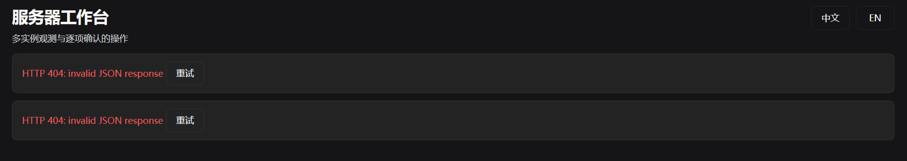
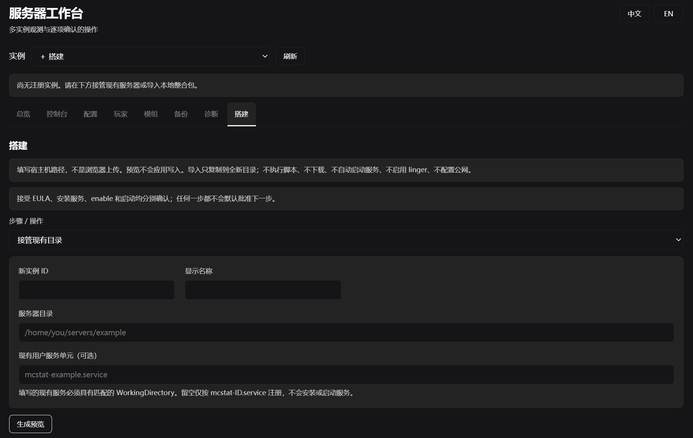

一开始只是想开个 Minecraft 服务器。

把《香草纪元：食旅纪行》的服务端和原来的世界搬到 Linux 笔记本上，Windows 负责玩，笔记本负责开服，再让朋友也能连进来。手头有机器、有整合包、有存档，听起来像是把文件搬过去、配好 Java 就行。

后来发现，Java 能启动只是第一关。

从 10 月 31 日折腾到 11 月 1 日，补记到 11 月 2 日凌晨，事情慢慢变成了：这边查端口，那边换联机路径，再给 DSH 写管理插件，最后还拿着真实世界文件修了一轮解析器。

这篇把经过记下来。时间统一按 UTC+8；截图和数值都是当时留下的记录，不是现在重新测出来的在线状态，也不是一份照着执行就能复刻的安装教程。

## 先把旧世界搬过去，别开成了一个新世界

这次没买云服务器，用的是手头的笔记本：

| 项目 | 当时的环境 |
| --- | --- |
| 系统 | Ubuntu 24.04，x86_64 |
| CPU / 内存 | i5-13500H，系统识别总内存约 15 GiB |
| 游戏 / 加载器 | Minecraft Java 1.20.1 / Forge 47.3.33 |
| Java | 独立安装的 JDK 17 |
| 客户端 | Windows，使用对应整合包 |
| 模组文件数 | 后续统计为 398 个 |
| 游戏监听端口 | 47060 |

Forge 服务端不是拿一个原版 JAR 随便跑起来就完事。这里用到的是它自己的启动参数文件：

```text
libraries/net/minecraftforge/forge/1.20.1-47.3.33/unix_args.txt
```

当时 JVM 堆给了 `-Xms4G -Xmx8G`，调整过 G1 参数，也移除了 `AlwaysPreTouch`。这只是这台机器当时的配置，不是什么通用最优解。整机也就十五六 GiB 内存，系统、DSH 和其他进程还得有地方待。

相比参数，更需要确认的是：**它加载的是不是原来的世界。**

启动一个全新的世界也能成功，控制台照样会有就绪日志，但那不叫迁移成功。这次对上传的世界归档和实际加载内容做过核对，元数据对应 1.20.1，`DataVersion=3465`。后来继续游玩，世界和备份体积都在增长，所以不同时间的容量数字也不能直接拿来判断“是不是搬错了”。

运行方式则改成了 systemd 用户服务 `mc.service`，不用再靠某个 SSH 窗口一直开着。检查入口也固定了下来：

```bash
# 服务管理器：这个用户服务现在是什么状态？
systemctl --user status mc.service

# 应用日志：Java 和 Minecraft 实际输出了什么？
journalctl --user -u mc.service -n 100 --no-pager

# 监听端口：服务实际开在哪个 TCP 端口？
ss -tln
```

这三样后来反复用到，因为它们回答的不是同一个问题。

## 服务开着，朋友还是进不来

最先查清楚的一次，是隧道转发错了端口。

SakuraFrp 的目标曾经指向 **9411**，而 Minecraft 实际监听的是 **47060**。目标修正、frpc 重启之后，这条联机路径才恢复。

隧道进程显示 active，看着确实很让人放心——但它只说明进程在运行，并不保证流量最后到了游戏服务。更别说 DSH 面板也有自己的端口：浏览器能打开面板，与 Minecraft 客户端能不能加入，完全是两件事。

另一次更朴素。


看到“未知的主机”，很容易开始查 DNS、看地址格式、怀疑网络。后来核对，**那次输入的地址末尾多了空格**。

截图只能证明客户端报了“未知的主机”，空格这个原因来自后续确认，不能从截图里直接读出来。不过下次复制地址时，我大概会先看看首尾，再去折腾 DNS。

还有这种：


`Connection timed out: getsockopt` 和前面的名字解析失败，又不是同一种故障。期间还遇到过连接重置、不同隧道节点表现不一致。校园网络下，直接访问笔记本的公网游戏端口没有成功；当时也确认 UFW 未启用，不能看到“连不上”就说是 Linux 本机防火墙挡了。

后来把验证拆成了三层：

| 路径 | 要确认的事情 |
| --- | --- |
| 本机回环 | Minecraft 自身是否启动，并能响应游戏协议查询 |
| Tailscale | 专网这一条路径是否可用 |
| SakuraFrp | 隧道是否真正转发到游戏服务，而不只是 frpc 活着 |

再往下，还要分清名字解析、TCP 连接、Minecraft 状态查询和真正进服。TCP 能握手，是一个证据；游戏协议能返回版本和人数，是另一个证据；玩家完整加入并实际游玩，还得继续验证。

这次做过 TCP 和 Minecraft 状态握手测量，但我不把它们写成“游戏里就有这么低的延迟”。同样，Linux 主机一次 DNS 查询慢，也不能直接套到 Windows 客户端身上。

## 掉线了，先别急着叫“崩服”

一边调配置、一边看服务，有时候特别容易把时间上靠近的两件事连在一起。

有一次以为服务器崩了，回头看日志，实际是收到了 `SIGTERM`，随后保存并退出，也没有对应的崩溃报告。至少从这段记录看，更像是一次正常停止或重启。它刚好发生在配置变更附近，也不足以证明就是面板把服弄坏了。

备份与超时也曾挨得很近。可当时没有足够的记录说明备份到底卡了主线程多久，就不能把它写成已经找到的根因。

后来调整了 SimpleBackups：

- 备份策略使用 `MODIFIED_SINCE_LAST`；
- 定时周期 60 分钟，完整备份周期 1440 分钟；
- 保留数量为 10。

这些调整是为了控制备份成本和磁盘增长，不是已经证明能修好卡顿的配方。备份要有，但不能只看着文件不断增加，就当恢复这件事已经稳了——完整恢复演练还没做。

`Can't keep up!` 也一样。启动时加载模组和世界出现一次，与运行中持续刷屏，不应该用同一个结论解释。

## 查得多了，干脆做个工作台

状态、日志、配置、玩家、模组、备份、诊断，还有两条联机路径，都要反复检查。于是 `mcstat-panel` 从简单的状态工具，慢慢扩成了 DSH 里的多实例工作台。

做它不只是为了把命令变成按钮，还得把操作边界先定好：

> 查询可以先做；写入先看预览、再确认。返回“已排队”，不等于操作已经成功。

Agent 也走独立工具和任务记录，而不是临时写一段 shell，就直接去改服务器。

不过，面板自己也先坏了一次。



页面出来了，两块红色报错也出来了：`HTTP 404: invalid JSON response`。

看见“JSON”就查前端 JSON，其实很容易走偏。那时怀疑过旧进程、重载和重复注册，最终还是启动日志给出了明确线索：

```text
StorageError: invalid unit name 'mcstat-panel'
```

宿主对存储单元名的要求是：

```text
^[a-z][a-z0-9_]*$
```

不能有连字符。

结果插件在打开存储时就失败了，后面的 HTTP 路由和 Agent 工具根本没注册上。前端能加载，不代表后端插件已经激活；请求自然也就只拿到了 404。

改的是**存储单元名**，从 `mcstat-panel` 换成 `mcstat_panel`。包名、插件 ID、skill provider 名没有跟着全局替换，因为它们各自有各自的命名规则。不能看起来像同一个名字，就拿一次替换把所有位置一起改了。

另一个前期怀疑也收了回来：profile 里同一个 ID 出现覆盖配置，不等于启动了两个插件实例。

修好以后，工作台总算正常显示了：



这张截图里还写着“尚无注册实例”。它不是下一条故障，而是当时注册表确实为空。这张图证明的是页面恢复了，不能拿来当“服务器已经运行”的截图。

接下来通过 `attach_preview` 生成接管计划，核对现有目录和 `mc.service`，审批后登记为 `survival`。这一步只登记，不改服务端文件，也没有顺便停服、启动或重新安装。

世界和服务器明明已经在那里，没必要为了让面板认识它，再把文件“导入”一遍。

## 到了验收，不能只看 active

11 月 1 日中午，明确请求开服之后，启动任务完成，记录里也有了新的 systemd invocation 和新的 Minecraft 就绪日志。

当次验收留下的结果是：

| 检查项 | 当时的结果 |
| --- | --- |
| 启动任务 | `completed` |
| Minecraft readiness | `ready` |
| 本机游戏协议查询 | 1.20.1，0/8 在线 |
| Tailscale 游戏协议查询 | 成功响应 |
| SakuraFrp 游戏协议查询 | 成功响应 |
| 进程内存 | 约 6.7 GB，十进制口径 |
| 模组文件数 | 398 |
| 配置 | hard，最多 8 人，视距和模拟距离均为 6 |

这不是实时监控数据，也不是完整的进服测试。资料里没有选用能明确证明成功进服的游戏内截图，所以这里能确认的是：**服务启动就绪，三条路径都完成了游戏协议查询**。

难度和人数也与早先接管预览时不同，记录到哪个阶段，就按哪个阶段写，不能没证据就算到某个操作者头上。

期间还有个容易误会的显示：面板曾把隧道标成 disabled，可外部的 `natfrp.service` 实际在运行，协议查询也成功。那是插件里没配置 tunnel provider，不是现实中的隧道停了。

面板知道的状态，和机器上实际存在的服务，还得对得上。

## 930 项测试全过，真实世界还是读不出来

开服以外，这两天还有一段很值得记的插曲。

检查 `refactor/v2` 的 `6cd28c5` 时，自动测试 **930 项全过**。拿真实模组世界的元数据一跑，却得到 `WORLD_UNREADABLE`。

先碰到的是安全预算。

真实元数据解压后约 **4.25 MiB**，约 **34.2 万个节点**，深度没有超过限制；解析器的节点预算却只有 10 万。文件不是坏的，而是合法数据比测试样本大，先被安全上限拦住了。

于是把节点数与累计列表元素的预算提高到 100 万，同时保留字节、深度、解压校验和取消保护，再增加接近真实规模的测试。不是为了让一个世界通过，就把所有限制都拆了。

预算过了，还没完。解析器又把大小写相似的字段当成了冲突。

实际文件里，这三项可以同时存在：

```text
Data.version = 19133     # 旧的存储格式字段
Data.Version = {...}    # 游戏版本元数据
Data.DataVersion = 3465
```

Java NBT 的键是精确、区分大小写的。先统一大小写，或者先做 Unicode 归一化，再判断是不是同名字段，看似在防歧义，实际却把合法文件合并成了“冲突”。

修复后，只精确匹配版本字段；相似名字不再被当成版本证据。关键字段精确重复、类型错误和版本冲突，仍然拒绝。

同一个世界重新验证，结果才对上了：

| 目标版本 | 探测结果 |
| --- | --- |
| 1.20.1 | `same`，DataVersion 3465 |
| 1.19.4 | `downgrade`，返回 `WORLD_TOO_NEW` 阻断 |

到 11 月 2 日凌晨，回归达到 **934/934 通过**，语法检查、前端产物一致性与打包检查也通过了；解包后的 CLI 还重新验了同版本与降级场景。

这次倒是很直观地体会到：测试全过，说明的是测试覆盖到的那些情况全过。真实世界一放进去，才知道小样本没碰到的地方在哪里。

## 最后，留下来的不只是一个能启动的服

插件现在可以协助 Agent 检查本地目录或 ZIP、生成导入计划、安装用户服务并验证启动。但“把整合包交给 Agent”，不应该等于“允许它执行包里所有东西”。

搭建流程被拆成了几步：

```text
只读检查
  → 导入预览与审批，或接管已有目录
  → 可信 Java 的独立版本探测
  → 用户本人明确接受 EULA
  → 服务安装预览与审批
  → 可选自启
  → 单独批准启动
  → 核验就绪日志、游戏协议和目标联机路径
```

没有哪一步会替后面所有步骤一起盖章。

包内 `run.sh`、Forge installer、未知 Java，不自动执行；manifest 里的依赖不自动下载，客户端包也不能当成完整服务端包。EULA 不替人接受，正版验证不自动关闭，RCON、防火墙和公网暴露也不顺手开启。

导入只到新目录；纯世界或单个元数据文件只检查，不提供覆盖恢复。离线世界备份不包含模组、配置和启动参数，hash 对上了，也不等于已经做完游戏级恢复演练。

这些边界当然让“一键开服”没那么一键。不过我宁愿多确认几步，也不想服务器明明已经在那里，Agent 为了帮我省事，先把世界重新收拾了一遍。

截至这篇补记的时间，插件准备为 2.0.0，用户文档也重写了，但本次发布改动**还没有提交、打 tag、推送或公开发布**。干净 DSH profile 安装、完整浏览器回归、真实导入到首次启动的全链路，以及备份恢复演练，都还需要继续补。

所以这篇先记到这里，不把它写成一份已经发布的插件广告。

本来只是想让朋友进来玩。两天之后，我倒是先学会了一件事：Java 活着、面板亮着、隧道开着，都只能各自证明一小部分。真正安心一点，是出了问题时，知道下一步该去查哪一层。

---

*配图说明：四张均为本次记录附带的历史截图，沿用提供素材的裁剪范围，仅转换为 WebP，未改写报错、界面状态或运行数字。本文不收录公网连接地址、登录 token 和玩家 UUID；错误画面及空实例页面也不作为成功进服的证明。*
